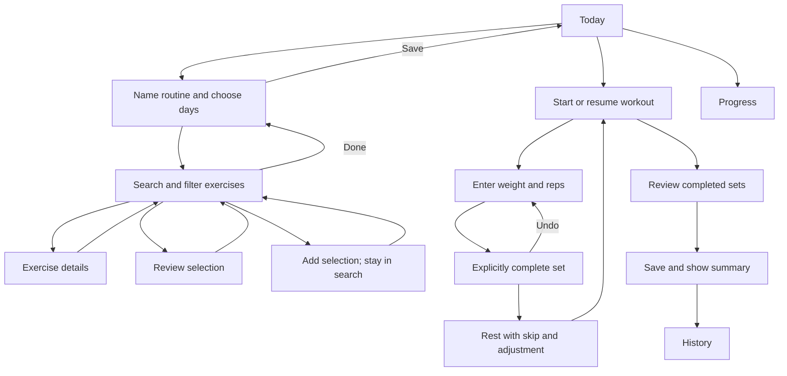

# Gym Log: UX research and wireframes

Date: October 10, 2026. Status: **proposal for review; no app redesign approved or implemented by this work**.

## Objective and evidence

Make choosing exercises and recording a workout easy enough to use between sets. The user's benchmark is the quality of leading gym apps. This review uses official product pages, help articles and their published interface examples; it is not a hands-on competitive usability study or a verified ranking. Published features demonstrate patterns worth evaluating, not proof that a design is faster. Strong's referenced help articles were last updated in 2021–2022 and may differ from its current build.

| Benchmark | Observed pattern, with primary source | Gym Log design inference |
| --- | --- | --- |
| Hevy | [Previous workout values](https://www.hevyapp.com/features/track-exercises/) exposes previous set performance beside current logging and supports copying it. Its [exercise library](https://www.hevyapp.com/features/exercise-library) combines search, equipment/muscle filters, details and exercise history. | Keep last performance in context. Separate choosing an exercise from opening its guide. Preserve selections across searches. |
| Strong | [Workout recording](https://help.strongapp.io/article/229-my-first-workout) supports reusable templates, editable sets, explicit completion and history. Its [rest timer](https://help.strongapp.io/article/231-rest-timer) starts after a completed set and can be adjusted or skipped. | Model draft values and completed sets distinctly. Keep undo and rest controls close to logging, and confirm which sets will be saved. |
| Fitbod | [Official product description](https://fitbod.me/) emphasizes equipment context and exercise demonstrations/cues alongside personalized programming. | Make equipment and movement identity easy to verify. Retain user-chosen routines; automated programming is not part of this proposal. |
| Ladder | [Official product description](https://www.joinladder.com/) emphasizes demonstrations, guided pacing and integrated rep/weight tracking. | Test a focused current-set view, with clear next action and rest state. Coaching subscriptions, audio coaching and nutrition are outside this pass. |

These are independent design inferences. No competitor assets, exercise media, code or brand treatments are reused.

## Proposed experience

Retain familiar Today, Progress, History and Settings navigation. Today has a dominant Start/Resume action and a direct path to routine editing. The preview contains one sample routine to make the flow testable; the real app must still start empty and allow multiple user-defined routines and schedules.

### Two logging layouts to compare

**Focused set (initial recommendation):** large labeled weight and reps fields, one Complete set action, completed-set list beneath it. This reduces simultaneous choices and improves target size. Tradeoff: it is slower to compare/edit several unfinished sets at once.

**Compact table:** all sets visible, explicit Log set/Undo controls, shared exercise context and previous performance. This supports quick scanning and editing across sets. Tradeoff: fields are smaller and the screen demands more attention.

These alternatives are proposals, not a commitment to support two modes in production. Pick a default after trying the same tasks in both. Color is restrained coral with charcoal/cream surfaces, following the approved mascot palette. This is a medium-fidelity interaction wireframe, not the final visual design.

### Screen contracts

| Screen | Primary action and information | Essential behavior |
| --- | --- | --- |
| Today | Start or Resume; routine name and exercise count | Resume retains draft values and selected exercise; routine edit does not start a session. |
| Routine | Editable name, repeat days, exercise list, Add exercises, Save | User owns content and schedule. Full production design must retain ordering, exercise-specific set targets, routine creation/deletion and multiple routines. The first preview simplifies these. |
| Search | Persistent name search, All/Saved, staged filters, per-row details/selection, selection footer | Adding stays in search. Search text, filters and pending selection survive details/review. Empty, loading, offline and rate-limit states are specified. |
| Selection review | Pending items in add order | Remove a pending item without losing the query; commit adds selected exercises once. |
| Exercise detail | Identity, equipment, target and media placement | Return to exact prior context. Preview contains no exercise animation or fabricated instruction content. Production keeps source attribution and manual playback. |
| Active workout | Exercise selector, previous performance, weight/reps, Complete, Undo, rest | Values entered are drafts until explicitly completed. Optional effort never appears as missing required weight/reps. Rest does not take over the whole screen. |
| Finish review | Completed-set count, warning about unfinished drafts | Keep training or save completed sets. No accidental session finish. Zero-completed-set discard/recovery requires a separate production state. |
| Summary | Completed sets, lifted volume and measurement availability | Missing Health readings display unavailable/pending, never zero or invented estimates. Save workout logging independently of Watch success. |
| Progress | Exercise-specific trend with units and history access | Compare the same exercise and metric. Sample data is labeled. Real empty state must ask for more sessions, not fabricate a trend. |
| History | Saved session and actual completed sets | Session summary links back to the workout record. |
| Settings | Watch status and connection help | Tell the user whether recording started. Preview never claims device connectivity. |

## Existing requirements preserved

- Exercise discovery, production names, filter values and instructions remain API-driven. Static wireframe fixtures are isolated from the app and are not a production fallback.
- Preserve the existing one-hour response TTL, request coalescing, debounce, pagination, cooldown handling and source attribution. This research does not alter API terms or improve source resolution.
- Name-search relevance remains exact/all-normalized-word matching with supported aliases; results describe loaded candidates. The preview searches only eight fixtures and is not an API correctness or coverage test.
- Users keep search and navigation context during ordinary backgrounding. A fresh process opens Today while saved data and unfinished sessions remain intact.
- Explicit set completion and undo remain. Weight/reps autosave does not mean the set is completed. Prior performance is context, not a recommendation to increase load.
- Real sensor readings require the Watch recording path; no calorie estimates based only on reps, weight or time. Current physical-device acceptance remains unresolved.
- Do not replace the approved icon, user data, app identity or signing configuration.

## State and accessibility requirements for implementation

Search must specify: initial browse, debounced loading, results, no matches, partial-page results with Load more, existing selection, Added, API unavailable, offline Saved, cooldown, and failed save retaining selections. A generic error cannot send the user home. Filters apply together; Cancel preserves prior values. New filter choices must come from the provider, not this preview's short list.

Workout must specify: empty workout, draft field, invalid entry, keyboard shown, complete, undo, rest, interrupted session, save failure, finish with unfinished sets, no Watch, connecting, recording, connection loss, awaiting summary and unavailable measurements. Persistence failures need truthful copy; never display saved until the write succeeds. Completed-set edits should make the update explicit.

Production targets: at least 44 pt touch targets, visible field labels/units, accessible completion state not color alone, Dynamic Type reflow, light/dark contrast, VoiceOver labels, reduced-motion support and keyboard-safe primary actions. The web preview cannot validate native keyboard behavior, VoiceOver, haptics or iOS safe areas.

## Prototype scope and review

Inline source: [Archived standalone preview](designs/ux-wireframes.html) · [Editable source](designs/ux-wireframes.fragment.html).

Use the Screen selector to jump between flows. Use the host's variant picker below the preview to switch Focused set / Compact table. Both maintain independent sample state. Optional host design controls toggle previous-performance display and search loading/offline/rate-limited states. The rest timer is an explicitly labeled static interaction preview; +30 and Skip work. No API requests, live device integration or production data writes occur.

Try the same script in both layouts:
1. Rename the routine and change a training day.
2. Add exercises; search “dumbbell row” or “DB rows”; select a row, search “curl”, select it, review and add. Confirm search stays open.
3. Cancel one filter change, then apply another. Confirm no-match recovery preserves the query.
4. Start a workout, change 30 lb × 10 to 35 lb × 12, complete, undo and complete again. Confirm draft and completion states are distinguishable.
5. Skip rest, choose another exercise, minimize and resume. Finish and verify only completed sets appear in History.
6. Compare finger travel, reading effort and errors between variants.

Proposed evaluation targets (not measured results): at least 4 of 5 representative users finish the routine/add/log/finish tasks without help; users can explain draft versus completed correctly; repeat a prefilled set with one explicit completion tap; add multiple exercises without losing query/selection; recover an accidental completion with one Undo; zero critical clipping or invisible action labels across supported text sizes. Record completion time, mis-taps and backtracking before claiming parity or improvement over competitors. A within-person test should counterbalance which layout is tried first.

## Approval and next design pass

Review the overall flow and preferred logger first. Then flesh out multi-routine management, reorder/edit targets, keyboard states, failure recovery, Health status transitions and adaptive typography in the chosen direction. Validate on the user's actual phone before implementation rollout. Approval of this wireframe does not resolve media-source quality, Watch setup or App Store readiness.

## Validation

Validation results are recorded after local preview checks; this is separate from app tests and physical-device verification.

October 10 preview checks: both layouts passed automated search alias matching, cross-query selection, selection review, add-without-dismissal, filter cancel/apply, invalid reps, complete/undo, rest adjustment/skip, finishing, computed volume and History checks. Eight top-level screens were checked at 320, 390 and 736 px in both light and dark appearance, in each layout (96 layout states), with no detected horizontal overflow or JavaScript errors. Rendered Today, focused logging and narrow dark compact logging screenshots were inspected. Narrow day-selection controls wrap to maintain usable targets. These checks validate the local web prototype only; they do not establish native accessibility compliance, real API behavior, Health connectivity or comparative usability superiority.
